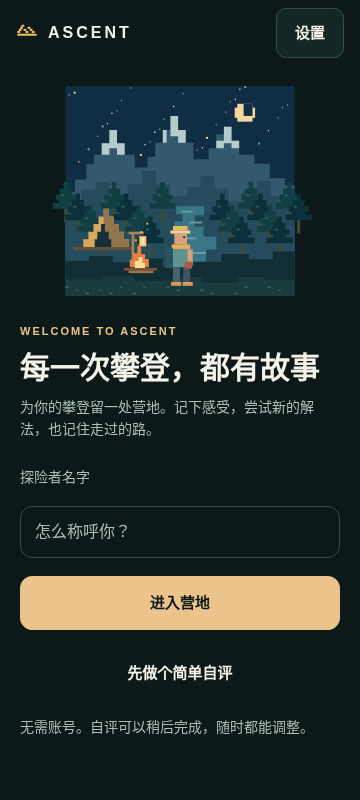
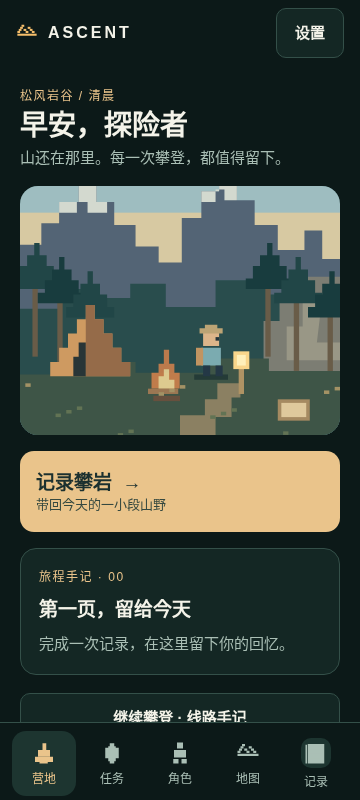
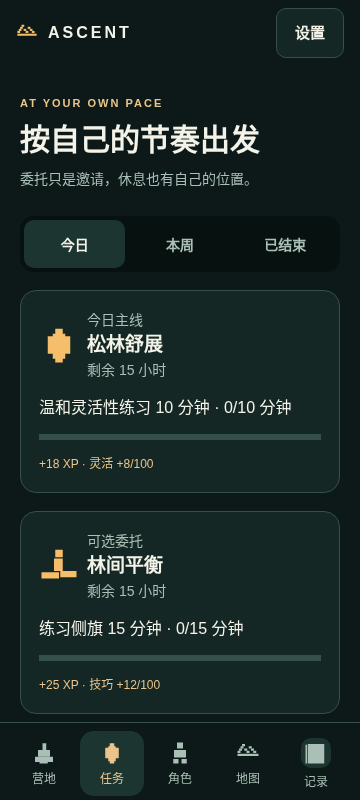
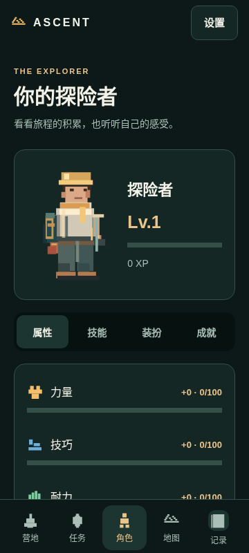
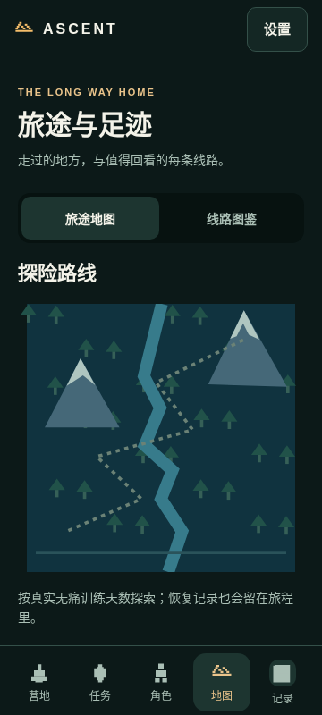
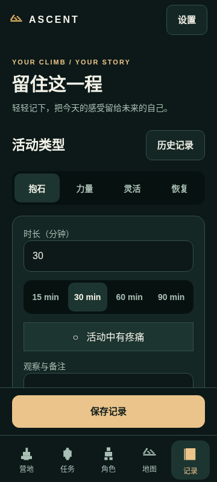
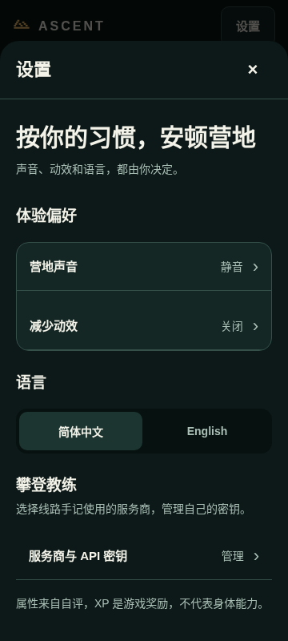

# ASCENT mobile UI review

## What was wrong

The previous presentation gave nearly every button, filter, selected state and
record action the same weight. Dense borders, small secondary text and competing
headers made the app feel assembled from separate features. The journal's save
button disappeared below a long form; entering the app led straight into a five
question assessment; settings were a stack of action buttons; companions required
finding small scene hotspots. Detail pages used narrow framed popups even for
long forms. These are layout and interaction problems, not just palette issues.

## Direction and scope

Keep the original morning pixel valley and explorer identity. Use native,
readable surfaces around that world: deep pine/ink, warm paper text, muted sage,
and one brass/gold primary action. We are applying common mobile interaction
patterns, not copying a competitor's artwork or claiming equivalent usability.

Shared rules: 20dp page margins, 18dp surface padding, 16–18dp gaps, 16sp body
copy, 14sp secondary text with 22sp line height, 30sp page titles and 19–22sp
section titles. Text uses system fonts and remains scalable. Short English
location labels are decorative; core controls remain Chinese/English localized.
Buttons distinguish primary, secondary, quiet, choice and destructive tones.
Choices use sage and selected-state semantics; gold is reserved for main actions.
Action controls are at least 50dp tall, segmented controls 48dp, input fields
52dp and navigation items 64dp. Long labels may wrap. Touch targets and actual
font scaling still require Android device checks.

### Screen changes

| Surface | Resulting behavior |
| --- | --- |
| Welcome / assessment | Name + enter camp is the first screen. Self-assessment is optional; its five questions have progress and equal-width choices. Existing profiles bypass welcome. |
| Camp | Shorter panoramic world keeps the record action and recent memory higher on the page. Supporting links and readiness follow instead of competing with the scene. |
| Navigation | Stable five tabs, clear active pill and labeled icons. Settings is a plainly named entry instead of a mixed language/settings action. |
| Recording | Activity and duration selections are grouped; notes are multiline; optional parameters stay expandable. A persistent save footer stays outside the scrolling form. Keyboard events hide bottom navigation. Inline validation/storage errors are echoed beside save. |
| History / completion | Consistent spacious detail surface, readable records and summaries. Existing edit/delete, actual rewards and camp return remain wired to real storage. |
| Commissions | Today/week/history segmented navigation, distinct card hierarchy, readable progress and explanatory empty state. Accept/record is the primary action in detail. |
| Explorer | Compact identity card, segmented sections, attributes on two-line rows rather than five cramped columns. Skills/badges use spaced surfaces; outfit explains the current look with the existing character art. |
| Map / route collection | Clear page purpose and map/collection navigation; route empty state gives a next step. Route editing groups identity, attempt and optional beta/media. |
| Notebook / coach | Shared surfaces and control hierarchy, main experiment/review actions distinguished from selection and delete. API region/model fields expand separately from ordinary key entry. Saved advice and offline outcome controls remain first. |
| Settings | Grouped setting rows with current values, language selection, separate coach/key management. |
| Companions / collections | Familiar morning world plus labeled, full-width companion rows. Pack, stories, trail signs, commissions and explorer links remain accessible. Placed items remain visible; collection/story dialogs use the same readable surfaces. |
| Detail screens | Full-width, tall native modal surfaces with a persistent heading/close control and independently scrollable body; no decorative gold frame around long forms. Reduced-motion preference disables modal fades and reward spring. |

No profile, journal, XP, quest, route, language, notebook or key storage schema was
reset. Existing reward and pain protection rules are unchanged. There are no new
native dependencies or external assets in this UI change.

## Runtime previews

These are **browser renders of the actual React Native components**, not Android
captures or concept mockups. Storage, media, secure keys, audio and provider calls
are substituted in the browser harness. The notebook answer example is scripted.
The browser root is fixed to the viewport so the navigation/footer behavior can
be checked, rather than expanding the entire app into a long web document.

| Main pages | Preview |
| --- | --- |
| Welcome |  |
| Camp |  |
| Commissions |  |
| Explorer |  |
| Map |  |
| Journal with persistent save |  |
| Settings |  |

Further previews in `evidence/`: `ui-completion-web`, `ui-routes-web`,
`ui-route-editor-web`, `ui-skills-web`, `ui-outfit-web`, `ui-badges-web`,
`ui-companions-web`, `ui-notebook-web`, and `ui-key-settings-web` (all `.png`).
Matching `ui-compact-…` files show the 320×720 walkthrough. The updated
`climb-next-step-web-preview.png` shows a saved notebook cue in the shared UI.

## Verification

- `npm run check`: TypeScript and all 16 progression, provider and notebook tests
  passed. Final styling refinements also passed TypeScript.
- Browser walkthrough at **360×800 and 320×720**: welcome → camp; all five tabs;
  record/save/completion; settings; route collection and editor; explorer skills,
  outfit and badges; companions; notebook; key setup and profile persistence.
- Compact notebook/key screen check found no interactive elements outside the
  viewport horizontally. This is not a blanket guarantee for every possible
  content length or Android font scale.
- Notebook regression: offline outcome → simulated advice → correction/outcome →
  next request carrying feedback → today's review → reload and find saved data.
- Persistent-footer regression passed: failed write retains input; retry and
  double-click save exactly one record; completion remains visible; reload keeps
  the linked camp memory and recall opens the actual record. Receipt actions
  have a 250ms touch guard to prevent the second save tap dismissing the new
  feedback surface. Successful save dismisses the keyboard.

Still unverified: Android keyboard resize/insets and system back, TalkBack focus,
large system font sizes, real camera/media/Keystore/audio, device performance and
native persistence through process death. No Android screenshots or recording
are claimed. User preference and usability must be judged by using the installable
version; the screenshots and passing tests cannot establish those outcomes.

## Installable Android version

Final build succeeded on application source `6e9fb0c` (including the receipt
repeated-tap fix):
https://github.com/FanFront/rockClimbingHero/actions/runs/40299435213

ARM64 APK artifact:
https://github.com/FanFront/rockClimbingHero/actions/runs/40299435213/artifacts/12639882003

Later commits only add documentation and browser evidence. Artifact downloads
require repository access and expire according to GitHub retention settings.
This UI PR is stacked on the climb notebook PR; the APK contains both features.
Device verification remains outstanding. Passing a build is not usability acceptance.
